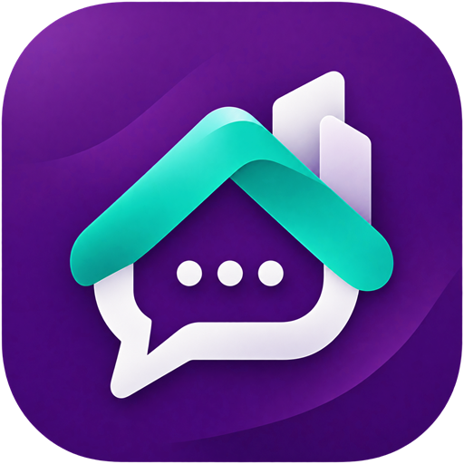

[English](/README.md) | [فارسی](/README.fa_IR.md)

<div align="center">

#  گفتگوی اوج

[](https://opensource.org/licenses/MIT)


**پلتفرم پیام‌رسان امن و سبک برای میزبانی شخصی**

</div>

راهنمای کد پروژه: [نقشهٔ فایل‌ها و تمام کامپوننت‌ها](MD/PROJECT_MAP.md).

## قابلیت‌های کلیدی

- 💬 **انواع چت**: پیام مستقیم، گروه و کانال
- 🍃 **دیتابیس**: درایور بومی MongoDB با collectionهای ایندکس‌شده و بازیابی تراکنشی رویدادها؛ replica set الزامی است
- 📁 **پشتیبانی از رسانه**: آپلود فایل، پیام صوتی، تبدیل ویدئو
- ✍️ **پیش‌نویس و صف ارسال**: پیش‌نویس متن و پاسخ روی همان دستگاه و صف ماندگار پیام‌های جدید متنی و دارای پیوست
- 🎧 **پخش ویس**: حفظ سرعت پخش از ۱ تا ۲ برابر و جابه‌جایی نقطهٔ پخش روی شکل موج
- 🔔 **Push Notification**: اعلان وب با VAPID
- 📞 **تماس صوتی و تصویری**: تماس‌های صوتی و تصویری نظیر‌به‌نظیر و امن
- 📡 **کانال‌های ریموت**: آینه‌کردن کانال‌های Telegram یا گفتگوی اوج (نسخه v0.10.3+)
- 🛡️ **پنل مدیریت**: رابط مدیریتی کامل با نقش مالک (نسخه v0.11.0+)
- 🔒 **امنیت**: رمزنگاری، هش bcrypt، محدودیت نرخ
- 📱 **PWA**: اپلیکیشن وب نصب‌شدنی
- ☁️ **نصب ابری**: نصب به صورت PaaS و CaaS با پشتیبانی از فضای ابری
- 🌍 **چندزبانه**: پشتیبانی از انگلیسی و فارسی

## نصب سریع

ابتدا replica set در MongoDB 8 یا استقرار Atlas را تنظیم کنید. `MONGODB_URI` در `.env.example` عمداً خالی است؛ URI خصوصی خود را در `.env` وارد کنید و `MONGODB_DATABASE=ouj_chat` را نگه دارید. SQLite و PostgreSQL فقط منبع ورود دادهٔ قدیمی هستند. [راهنمای MongoDB](docs/fa/MongoDB.md) نصب Docker محلی، Atlas، نصب وابستگی‌ها، توسعه و اجرا، ورود داده، پشتیبان و آزمون integration را پوشش می‌دهد. باینری آپلودها در provider محلی/S3 باقی می‌مانند و به پشتیبان جدا نیاز دارند.

سورس بررسی‌شده را از مسئول استقرار دریافت کنید. روی سرور Ubuntu (نسخه 22.04+) با دسترسی `sudo`، اسکریپت محلی نصب را از ریشهٔ مخزن اجرا کنید:

```bash
bash scripts/install.sh
```

این اسکریپت پیش‌نیازها را نصب می‌کند، برنامه را build می‌کند، Nginx را کانفیگ می‌کند و می‌تواند SSL را هم برایتان راه‌اندازی کند. بعد از نصب، هر زمان با این دستور دوباره به آن دسترسی دارید:

```bash
ouj-chat-deploy
```

> [!TIP]
> داشتن یک دامنه که به IP عمومی سرور شما اشاره کند پیشنهاد می‌شود، و برای push notification به HTTPS نیاز دارید (به‌جز روی `localhost`).

## مستندات

از [مستندات محلی گفتگوی اوج](docs/fa/index.md) استفاده کنید یا برای مرور آن `npm run docs:dev` را اجرا کنید:

- [قابلیت‌های گفتگو](docs/fa/Chat-Features.md)
- [راه‌اندازی و انتقال MongoDB](docs/fa/MongoDB.md)
- [اسکریپت نصب](docs/fa/Deployment-Script.md)
- [نصب از طریق Docker](docs/fa/Installation-Docker.md)
- [نصب ابری](docs/fa/Cloud-Deployment.md)
- [نصب دستی](docs/fa/Manual-Installation.md)
- [کانفیگ Nginx](docs/fa/Nginx-Configuration.md)
- [گواهی‌های SSL](docs/fa/SSL-Certificates.md)
- [اجرا پشت CDN](docs/fa/CDN-Setup.md)
- [اجرا روی دامنه + subpath](docs/fa/Subpath-Hosting.md)
- [متغیرهای محیطی](docs/fa/Environment-Variables.md)
- [فضای ابری](docs/fa/Object-Storage.md)
- [ورکر مدیا](docs/fa/Media-Worker.md)
- [پنل مدیریت](docs/fa/Admin-Panel.md)
- [راه‌اندازی Remote Channel](docs/fa/Remote-Channel-Setup.md)
- [پراکسی Push Notification](docs/fa/Push-Notification-Proxy.md)
- [تماس صوتی و تصویری](docs/fa/Voice-Video-Calls.md)
- [به‌روزرسانی برنامه](docs/fa/Updating.md)
- [دستورات دیتابیس](docs/fa/Database-Commands.md)
- [عیب‌یابی](docs/fa/Troubleshooting.md)

## قدردانی از پدیدآورندگان متن‌باز

- پدیدآورندهٔ اولیه: [@bllackbull](https://github.com/bllackbull)
- مشارکت کنندگان: [@nkhalili](https://github.com/nkhalili), [@modos](https://github.com/modos), [@iPmartNetwork](https://github.com/iPmartNetwork)

## مشارکت

- از تقاضای مشارکت، استقبال میشود.
- برای مشارکت، از مخزن و سامانهٔ پیگیری مسئله‌ای استفاده کنید که مسئول فعلی استقرار معرفی می‌کند.
- برای اطلاعات بیشتر، راهنمای [Contributing](/CONTRIBUTING.md) را ببینید.

## حمایت

برای پشتیبانی با مسئول استقرار گفتگوی اوج خود تماس بگیرید. نشانی مخزن، نسخه‌ها و پشتیبانی به استقرار شما بستگی دارد.

## لایسنس

این پروژه تحت لایسنس MIT منتشر شده است. برای جزئیات بیشتر، فایل [LICENSE](LICENSE) را ببینید.
