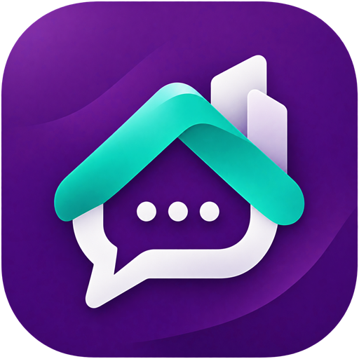

[English](/README.md) | [فارسی](/README.fa_IR.md)

<div align="center">

#  Ouj Chat

[](https://opensource.org/licenses/MIT)


**Secure, lightweight and self-hosted chat platform**

</div>

Project source guide: [File and component map (Persian)](MD/PROJECT_MAP.md).

## Key Features

- 💬 **Chat Types**: Direct messages, groups, and channels
- 🍃 **Database**: Native MongoDB driver with indexed collections and transactional event recovery; a MongoDB replica set is required
- 📁 **Media Support**: File uploads, voice messages, video transcoding
- ✍️ **Drafts & Sending Queue**: Device-local text/reply drafts and a persistent queue for new text and attachment messages
- 🎧 **Voice Playback**: Remembered playback speed from 1× to 2× and waveform seeking
- 🔔 **Push Notifications**: Web push with VAPID
- 📞 **Voice & Video Calls**: Real-time peer-to-peer and secure voice and video calling
- 📡 **Remote Channels**: Mirror Telegram or Ouj Chat channels (v0.10.3+)
- 🛡️ **Admin Panel**: Full management interface with owner role (v0.11.0+)
- 🔒 **Security**: Encryption at rest, bcrypt hashing, rate limiting
- 📱 **PWA**: Installable progressive web app
- ☁️ **Cloud Deployment**: PaaS and CaaS deployment with object storage support
- 🌍 **i18n**: English and Persian/Farsi support

## Quick Start

Configure a MongoDB 8 replica set or Atlas deployment first. `MONGODB_URI` is intentionally blank in `.env.example`; enter your private connection URI in `.env` and keep `MONGODB_DATABASE=ouj_chat`. SQLite/PostgreSQL are legacy import sources only. The [MongoDB guide](docs/MongoDB.md) covers local Docker, Atlas, dependency installation, development/start commands, imports, backups and integration tests. Binary uploads remain in the configured local/S3 provider and need their own backup.

Obtain a reviewed source checkout from your deployment maintainer. For an Ubuntu server (22.04+) with sudo access, run the local deployment script from the repository root:

```bash
bash scripts/install.sh
```

The script handles dependencies, builds the app, configures Nginx, and can set up SSL for you. After installation, access it again anytime with:

```bash
ouj-chat-deploy
```

> [!TIP]
> A domain name pointing to your server's public IP is recommended, and HTTPS is required for push notifications (except on `localhost`).

## Documentation

Read the [local Ouj Chat documentation](docs/index.md), or run `npm run docs:dev` to browse it:

- [Chat Features](docs/Chat-Features.md)
- [MongoDB Setup & Migration](docs/MongoDB.md)
- [Deployment Script](docs/Deployment-Script.md)
- [Install via Docker](docs/Installation-Docker.md)
- [Cloud Deployment](docs/Cloud-Deployment.md)
- [Manual Installation](docs/Manual-Installation.md)
- [Configure Nginx](docs/Nginx-Configuration.md)
- [SSL Certificates](docs/SSL-Certificates.md)
- [Running behind a CDN](docs/CDN-Setup.md)
- [Running behind a domain + subpath](docs/Subpath-Hosting.md)
- [Environment Variables](docs/Environment-Variables.md)
- [Object Storage](docs/Object-Storage.md)
- [Media Worker](docs/Media-Worker.md)
- [Admin Panel](docs/Admin-Panel.md)
- [Remote Channel Setup](docs/Remote-Channel-Setup.md)
- [Push Notification Proxy](docs/Push-Notification-Proxy.md)
- [Voice & Video Calls](docs/Voice-Video-Calls.md)
- [Updating the deployed app](docs/Updating.md)
- [Database Commands](docs/Database-Commands.md)
- [Troubleshooting](docs/Troubleshooting.md)

## Open-source Attribution

- Original author: [@bllackbull](https://github.com/bllackbull)
- Contributors: [@nkhalili](https://github.com/nkhalili), [@modos](https://github.com/modos), [@iPmartNetwork](https://github.com/iPmartNetwork)

## Contributing

- Contributions are welcome.
- Coordinate with the current deployment maintainer using the repository and issue tracker they provide.
- Checkout [Contributing](/CONTRIBUTING.md) guideline for more information.

## Support

Contact the operator of your Ouj Chat deployment for support. Repository, release, and support URLs are deployment-specific.

## License

This project is licensed under the MIT License. See the [LICENSE](LICENSE) file for details.
